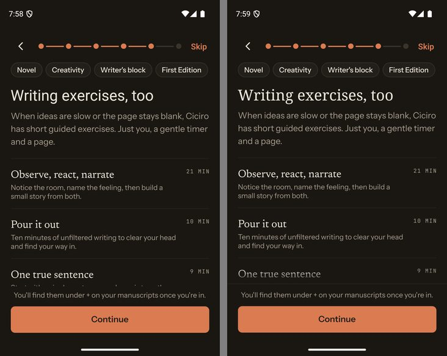
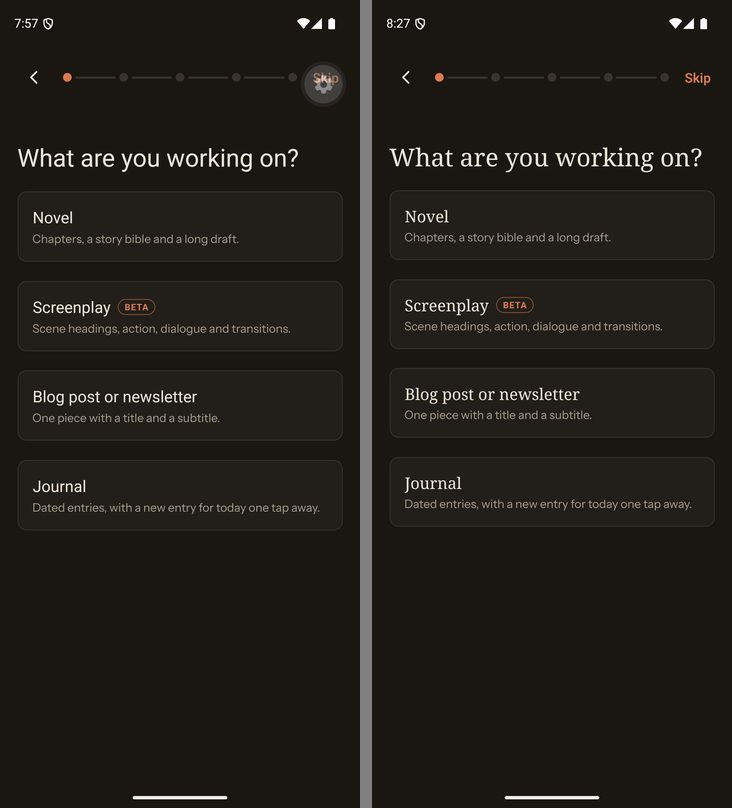
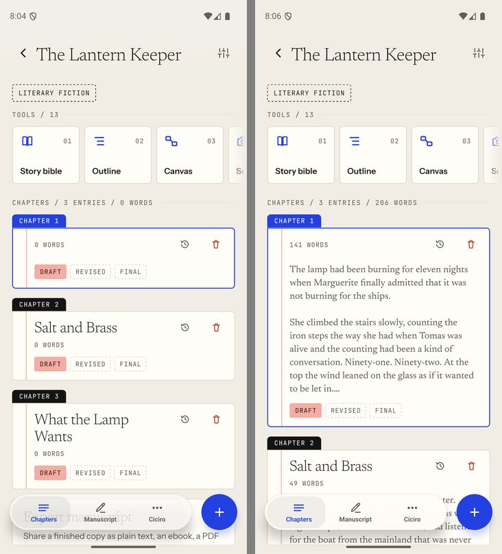
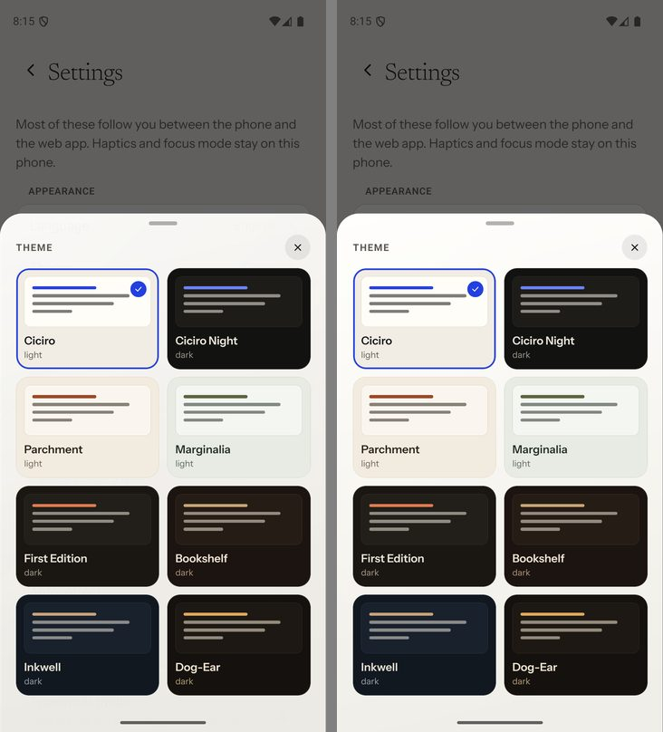
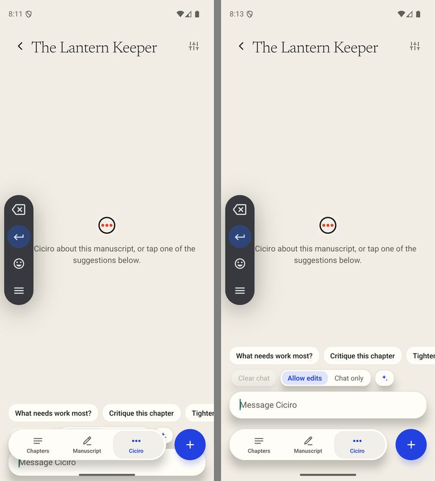
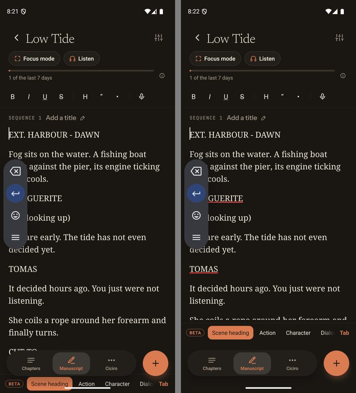
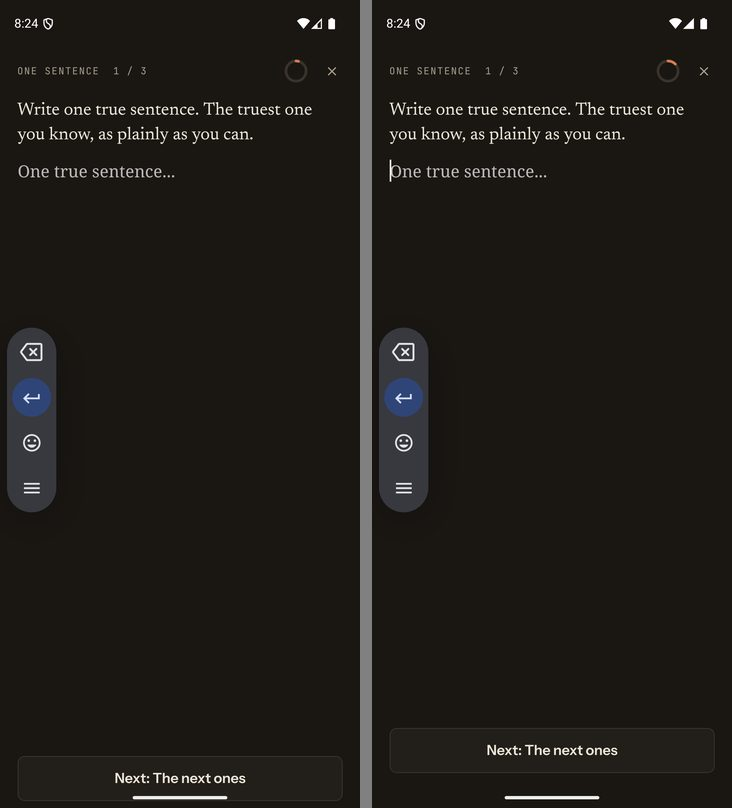
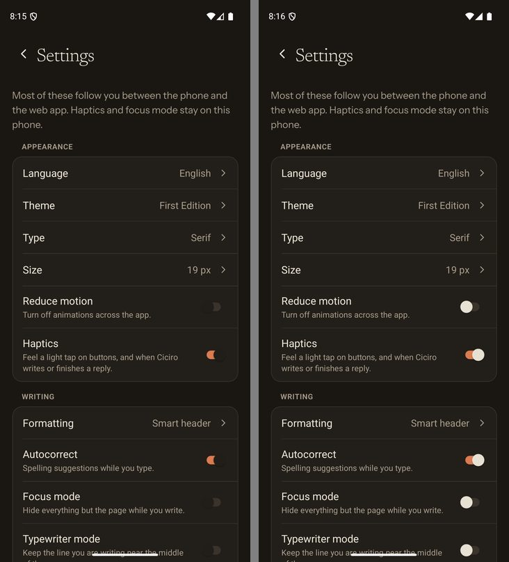
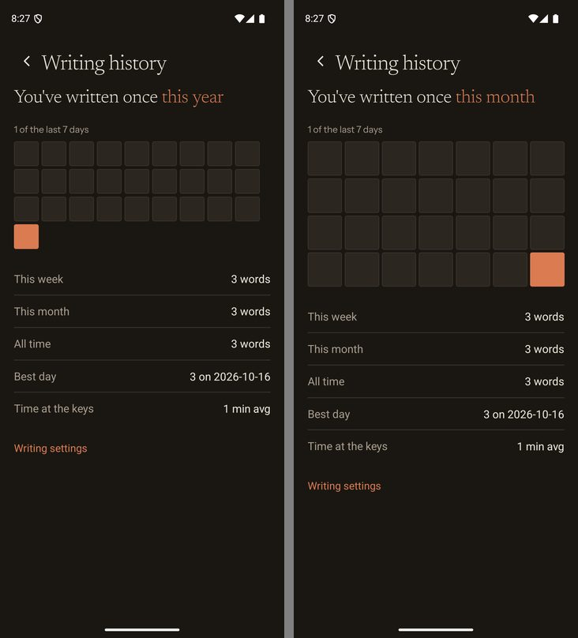

# Android walk-through

A pass through `apps/mobile` on an Android emulator as a writer would use it, fixing what
was Android-specific or plainly broken. The app's look is unchanged; these are fixes to how
that look lands on Android. Left of each image is before, right is after.

Setup: Pixel-class AVD (Android 16, 1080x2424, gesture navigation), the debug dev client
(`npx expo prebuild --platform android` then `npx expo run:android`), Metro, and a local web
server (`CICIRO_REQUIRE_AUTH=true npm run dev` with `adb reverse` for its port and Metro's).
`/android` is generated and gitignored.

## Fixed

### Onboarding footer clipped a row (the known nit)

On a short screen the writing-exercises step cut the last row's tagline just above the pinned
footer. `OnboardingFrame` now fades the list out above the footer, and draws a hairline on the
footer, only while more of the list is still below it.

### Titles, the editor and the demos fell back to sans

`fonts.serif` was `"Georgia"`, which Android does not ship, so every serif title, the manuscript
editor and the onboarding demos rendered in the system sans. Android now names the generic
`"serif"` family (and `"sans-serif"` for the sans); iOS is unchanged.

### Blur did nothing, so text showed through floating surfaces

`expo-blur` on Android blurs only what sits inside a registered `BlurTargetView`; our `BlurView`s
fell back to no blur and logged a warning on every render. Translucent surfaces (the floating
tab bar, the header band, bottom sheets) therefore let the page text bleed through. On Android
these are now opaque (`lib/blur-support.ts`: `BLUR_SUPPORTED`, `glassWashAlpha`); even a 0.95
wash left ghosted text, so the fill is fully solid. iOS keeps its blur.

### The chat composer sank behind the tab bar

Android's floating IME add-ons (voice typing's strip, the stylus toolbar) report the keyboard as
visible while covering nothing. The chat then dropped its tab-bar clearance and the composer
sat under the floating tab bar. `isRealKeyboard` (height of at least 120dp) decides what counts.

### The screenplay bar and the exercise's Next button sat on the gesture bar

Same cause on two more screens. `useCoveringKeyboard` (`lib/use-covering-keyboard.ts`) is now
the one place that decides it, used by the manuscript tab, the exercise page and the three
onboarding demos.

### Switch thumbs vanished in dark themes

The thumb used the panel colour, near-black on a near-black track. On Android, a dark panel now
gets the theme's ink colour as its thumb (`lib/switch-theme.ts`).

### Writing history heatmap had an orphan cell

28 days in a wrapping row laid out 9 + 9 + 9 + 1 on a wide phone. It is now four rows of seven.

## Checked and fine

Welcome, sign in and sign up, hardware back, the manuscripts list, chapters, the manuscript
editor (typing, selection, format bar), the Ciciro tab, story bible, scan notes, outline,
deadline (the system date picker), the screenplay and journal editors, the exercise flow,
settings and every theme in light and dark, and privacy choices.

## Deliberately left for later

- **System accent colour.** Text-selection handles, the caret and the system date and time
  pickers use Android's default teal. That is a static theme attribute; following the in-app
  theme needs a config plugin or a native change.
- **Screenplay page layout.** The page layout is an iOS-only native patch (the `script-layout`
  pref), so Android shows a script as flat paragraphs. The element bar, chips and typing speed
  work.
- **A freeze seen once.** After a first sign-in, tapping "Don't allow" on the privacy sheet left
  the manuscripts list ignoring touches until a relaunch (a Reanimated
  `synchronouslyUpdateUIProps` warning about a missing SurfaceMountingManager appeared at that
  moment). The emulator has 2GB of RAM and was swapping, and I could not reproduce it from
  Privacy choices in Settings. Worth a try on a real device.
- **A docked keyboard.** Gboard on this emulator only showed its floating toolbar, or nothing,
  so the real-keyboard path (the unchanged one) was not exercised. Check the chat, the screenplay
  bar and an exercise with a docked keyboard on a device.
- **Press feedback.** Buttons answer a finger with the shared scale and dim engine; there is no
  Material ripple. That is part of the app's identity, so it stays.
- **Outline rows** are tight vertically on Android (a fixed row height the drag maths depends on),
  and the **writing reminders** empty state sits close to its button.
- **Paywall.** Needs a RevenueCat Android key, so it shows "Subscriptions aren't available right
  now" locally.
